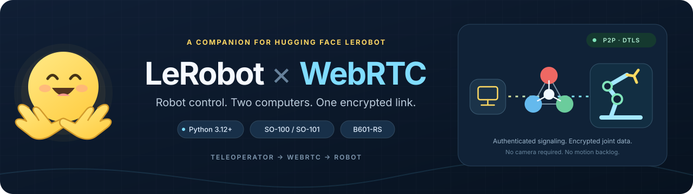

<h1 align="center">LeRobot WebRTC</h1>

<p align="center">
  
</p>

<div align="center">

[](https://github.com/kyeshmz/lerobot-webrtc/actions/workflows/verify.yml)
[](https://github.com/kyeshmz/lerobot-webrtc/actions/workflows/packages.yml)
[](https://docs.python.org/3.12/)
[](https://docs.astral.sh/ruff/)

</div>

**LeRobot WebRTC** transports joint-position actions between two computers using
LeRobot's hardware interfaces and an encrypted WebRTC data channel.

Use a physical SO-100/SO-101 **Teleoperator (leader)** to control a matching
**Robot (follower)** remotely. An opt-in reBot B601-RS follower also supports a
bounded, encoder-checked move-and-hold test.

This is a standalone companion to [🤗 LeRobot](https://github.com/huggingface/lerobot),
not an official LeRobot component or an auto-discovered Robot/Teleoperator plugin.
It does not provide camera streaming, dataset recording, policies, a browser UI,
force feedback, or automatic mapping between different arms.

## Highlights

- **Two computers, real LeRobot drivers:** matching SO leader/follower pairs and
  an opt-in B601-RS follower.
- **Small transport:** encrypted P2P WebRTC, optional TURN, and signaling that
  never carries joint commands.
- **Try before connecting hardware:** a finite demo, provider examples, real
  WebRTC tests, and fake-bus SDK checks.

## Quick Start

Requires **Python 3.12+**; SDK CI uses 3.12 and package CI tests 3.12/3.13. Install
[uv](https://docs.astral.sh/uv/getting-started/installation/), then run a finite,
hardware-free demo:

```bash
git clone https://github.com/kyeshmz/lerobot-webrtc.git
cd lerobot-webrtc
uv sync --locked
uv run --no-sync python examples/demo.py --duration 5
```

The demo starts separate signaling, simulated leader, and simulated follower
processes, establishes real local WebRTC control, then cleans them up. It needs
no serial ports, calibration, LeRobot hardware installation, or PyTorch. The
subprocess demo currently requires POSIX signal handling.

> [!IMPORTANT]
> Simulation verifies the transport and software lifecycle, not physical safety
> or internet/TURN traversal. For real hardware, complete local setup first and
> follow the [operating and safety guide](docs/usage.md).

## Robots & Control

The SO bridge transports `teleop_device.get_action()` to `robot.send_action()`.
It owns connection, serialized hardware I/O, command freshness, and shutdown.

| Bridge model | LeRobot device types | Joint positions |
| --- | --- | --- |
| `so100` | `so100_leader` → `so100_follower` | Six normalized values |
| `so101` | `so101_leader` → `so101_follower` | Six normalized values |
| `b601-rs` | `rebot_b601_follower`, RS motor family | Seven angles in degrees |

SO explicitly uses `use_degrees=False`: body joints `[-100, 100]`, gripper `[0, 100]`.
B601 includes wrist yaw and an angular gripper, and is limited here to RobStride
on **Linux SocketCAN**. These schemas cannot be mixed.

LeRobot's `--robot.type` / `--teleop.type` flags and this bridge's `--robot` flag
are separate CLI namespaces. The names above show their correspondence; the
commands are not interchangeable.

### Installation and hardware setup

For physical SO arms, install the hardware extra on both arm computers:

```bash
uv sync --locked --extra dev --extra hardware
```

This selects released `lerobot[feetech]==0.6.1`. Complete LeRobot's local
[SO setup/calibration workflow](docs/usage.md#set-up-physical-so-arms) before
network control; reuse the same device IDs and calibration cache.

For B601-RS, use a **separate prepared environment**. The reviewed driver is
LeRobot commit `ca69a2068462a37f7cdcb74180927a2f863d2bf7`, which reports version
0.6.2. Do not substitute an assumed PyPI release or install the SO-only hardware
extra as a B601 driver:

```bash
uv sync --locked --project examples/b601-sdk
```

The bridge assumes an already commissioned B601 and **never calibrates or zeros
it at runtime**. Do not resync a shared Jetson SDK or reconfigure CAN to start a
test. Follow the [B601-RS operating guide](docs/usage.md#b601-rs-opt-in-supervised-bench).

The released SO extra and source-pinned B601 SDK use separate manifests, environments,
and lockfiles. LeRobot's upstream security policy treats it as a
rolling release, not an assurance that arbitrary `0.x` versions are interchangeable.
See [package compatibility and versioning](docs/compatibility.md) for pins,
SemVer/PEP 440 conventions, upgrade checks and security-support limitations.

### Network control

```text
Teleoperator ── encrypted WebRTC, direct or TURN ── Robot
      └──────── authenticated SDP signaling ─────────┘
```

Set the same `LEROBOT_WEBRTC_TOKEN` on the signaling server and both endpoints.
The signaling server does not carry joint commands. Use a trusted private
network or WSS; public internet connections may also need an authenticated TURN
server.

Launch recipes: [manual simulation](docs/usage.md#try-without-hardware),
[physical SO](docs/usage.md#3-start-the-follower-then-the-leader),
[B601-RS](docs/usage.md#b601-rs-opt-in-supervised-bench), and
[STUN/TURN](docs/usage.md#across-nat--over-the-internet).

Real followers require explicit `--arm` consent; a physical B601 bench also
requires `--execute`. The default bench moves relative to its measured current
pose and holds. Home/return-to-start is optional via `--require-return`.

### Cloudflare, TURN and other WebRTC services

Start with the [examples index](examples/README.md):

| Example | Use it for |
| --- | --- |
| [Local P2P](examples/local/README.md) | A finite demo, no account or hardware |
| [Cloudflare Tunnel + TURN](examples/cloudflare/README.md) | WSS signaling and short-lived relay credentials |
| [coturn](examples/coturn/README.md) | An authenticated relay you host |
| [LiveKit](examples/livekit/README.md) | An optional, transport-only SDK probe—not robot control |

Tunnel is not TURN, and TURN is not an SFU. A LiveKit room URL or Cloudflare
Realtime SFU endpoint is not interchangeable with this bridge's signaling URL.

## Safety and Scope

- Mount/support the unloaded arm, clear its sweep, and keep an independent
  physical power cutoff within reach. Connection can configure and enable motors.
- `--arm` is startup consent, **not a hold-to-run dead-man switch**.
- Model/unit validation, follower-issued expiring permits, a latest-only mailbox,
  relative-target limits, and a local watchdog reject unsafe or stale software
  inputs. They are **not safety-rated collision, force, or real-time guarantees**.
- B601 adds CAN ownership, target-rate and per-joint deadline checks. Its 0.35°
  feedback margin does not widen commanded limits. Its guarded lifecycle differs
  deliberately from upstream's generic `connect()`.
- On exit, `hold` attempts a measured hold without explicitly disabling torque;
  it does not maintain feedback after transport closure. `torque-off` can let an
  unsupported arm fall. Neither policy verifies electrical torque state or
  guarantees physical standstill.

Read the [complete safety behavior and limits](docs/usage.md#safety-behavior-and-limits)
before hardware use. Do not use generic SDK `connect()` as a read-only probe.

## Development & Verification

```bash
uv sync --locked --extra dev
uv run --no-sync pytest -q
uv run --no-sync ruff check .
uv run --no-sync ruff format --check .
```

The default tests use simulated arms but real local signaling/WebRTC. Separate
`hardware_api` and `b601_api` suites exercise installed LeRobot drivers with fake
motor buses and forbid physical device access. See [driver verification](docs/usage.md#verify-the-real-drivers-too-without-moving-hardware)
for the separate dependency environments and commands. GitHub Actions runs these
checks; a green software run is not physical qualification.

A supervised B601-RS trial also verified real Mac↔Jetson WebRTC shoulder-pan
movement: 36 applied commands, approximately 0.36° measured movement for a 0.5°
request, and a completed measured HOLD write. This was a one-axis move-and-hold
test, not accurate homing, full seven-axis qualification, or guaranteed standstill.

## Resources

- [Operating guide](docs/usage.md): installation details, calibration wrapper,
  signaling, STUN/TURN, safety, and manual acceptance checks.
- [Comparison with other WebRTC integrations](COMPARISON.md).
- [Networking examples](examples/README.md) and [package/version policy](docs/compatibility.md).
- [LeRobot README](https://github.com/huggingface/lerobot#readme),
  [installation](https://huggingface.co/docs/lerobot/installation), and
  [hardware integration](https://huggingface.co/docs/lerobot/integrate_hardware).
- [SO driver source, v0.6.1](https://github.com/huggingface/lerobot/tree/v0.6.1/src/lerobot/robots/so_follower)
  and [B601 driver source, pinned revision](https://github.com/huggingface/lerobot/tree/ca69a2068462a37f7cdcb74180927a2f863d2bf7/src/lerobot/robots/rebot_b601_follower).
- [aiortc](https://aiortc.readthedocs.io/), [aiohttp](https://docs.aiohttp.org/),
  and [MotorBridge](https://github.com/motorbridge/motorbridge).
- [Cloudflare Realtime](https://developers.cloudflare.com/realtime/) and
  [LiveKit Python SDK](https://docs.livekit.io/reference/python/livekit/rtc/).

Maintained by [@kyeshmz](https://github.com/kyeshmz). [Issues and feedback](https://github.com/kyeshmz/lerobot-webrtc/issues)
and contributions are welcome. Run the relevant checks and label physical results
separately from simulation. Please acknowledge upstream LeRobot when
using its work; its [citation section](https://github.com/huggingface/lerobot#citation)
provides the recommended references.
